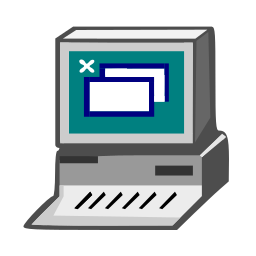
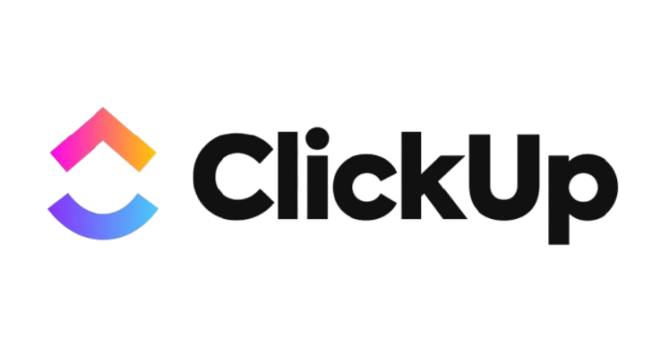

# Johnatan Coelho De Jesus Souza
## INTRODUÇÃO
Sou um desenvolvedor back-end, atualmente cursando Técnologo em Banco de Dados na Fatec de São José dos Campos. Ao longo da minha formação, venho construindo experiência em projetos Desktop e Web com Java, Spring Boot, MySQL, Angular, Vue.js e JavaScript, além de conhecimentos em metodologias ágeis, especialmente Scrum.

## CONTATO
 

## PRINCIPAIS CONHECIMENTOS

- **Back-End:** Java, Spring Boot e construção de API Rest
- **Front-End:** Angular, Vues.js, HTML, CSS e JavaScript
- **Banco de Dados:** MySQL, Oracle Database e Postgres SQL
- **Controle de Versão:** Git e GitHub

## PROJETO 2024-2 (1º Semestre)

### O PROBLEMA

Desenvolvimento de um sistema de utilidades matemáticas e manipulação de dados em ambiente de console, utilizando a ferramenta VisualG(Portugol).

### SOLUÇÃO ENTREGUE PELA EQUIPE 

Criação de uma calculadora científica com operações essenciais e esperadas pelo cliente: operações básicas (soma, subtração, multiplicação e divisão), cálculo fatorial, função de segundo grau, conversão de base numérica, concatenação de strings, juros simples e juros compostos. 

### REPOSITÓRIO
[Repositório projeto 2024-2 Calculadora Científica](https://github.com/IsaacOliveiraSouza/Aplicacao_Projeto_Integragor_Fatec)

### TECNOLOGIAS

| Tecnologia | Utilização |
|------------|------------|
|  | Linguagem portugol utilizada para o desenvolvimento da calculadora |
|| Ferramentas utilizadas para controle de versão e hospedagem de código remoto.|
|| Ferramenta utilizada para gestão de atividades e criação de Burn Up |

### CONTRIBUIÇÕES INDIVIDUAIS

#### BACK-END
- Cálculo de Fatorial: Implementação do algoritmo para multiplicação regressiva de inteiros positivos até 1.
- Menu de Operações: Criação da estrutura de seleção de opções para navegação do usuário.

#### TESTES E CORREÇÃO DE FALHAS
- Ajuste de Código e Correção de Falhas: Padronização da formatação do código e eliminação de bugs.

### HARD SKILLS

- **Lógica de programação**: desenvolvimento de funções, laços de repetição e estrutura condicional; 

- **Controle de Versão (GitHub e Git)**: Gerenciamento do código-fonte por meio de ferramentas de versionamento, estabelecimento de boas práticas de commits e prevenção de conflitos na mesclagem (merge) de branches.

### SOFT SKILLS

- **Trabalho em equipe**: Capacidade de se organizar como time e resolver soluções em conjunto.

- **Comunicação**: Habilidade de transmitir informações de forma clara, garantindo o alinhamento contínuo e a atualização com o time de desenvolvimento.

- **Aprendizado contínuo**: Proatividade na busca por novas ferramentas, conceitos e tecnologias para aprimorar constantemente as competências em programação.

## PROJETO 2025-1 (2º Semestre)

### O PROBLEMA

A instituição Fatec necessitava de uma ferramenta para o gerenciamento de horários dos professores, com um mecanismo para evitar a sobreposição de horários (o mesmo professor com disciplinas diferentes em um mesmo horário). Além disso, a ferramenta deveria permitir a criação das grades curriculares, organizando a estrutura dos cursos com os semestres e suas disciplinas.

### SOLUÇÃO ENTREGUE PELA EQUIPE 

Desenvolvimento de uma plataforma interna que permite o cadastro de cursos, com atribuição de disciplinas e organização por semestres, estruturando a grade curricular. Ademais, a ferramenta possui o gerenciamento de horários com alocação para os professores, evitando choques de horários, definição do posicionamento das aulas e controle do limite de aulas obrigatórias por semana. 

### REPOSITÓRIO

[Repositório projeto 2025-1 Gerenciador de horários](https://github.com/vp-p/gerenciador-horario-aula/)

### TECNOLOGIAS

| Tecnologia | Utilização |
|------------|------------|
|  | Linguagem de programação utilizada para o desenvolvimento do backend da aplicação, responsável pela implementação das regras de negócio e da lógica do sistema.|
|  | Sistema de Gerenciamento de Banco de Dados (SGBD) utilizado para armazenamento, gerenciamento e organização dos dados da aplicação. |
|  | Ferramenta de gerenciamento de projeto, atribuição e rastreamento de tarefas | 
|  | Ferramentas utilizadas para controle de versão e hospedagem de código remoto.|

### CONTRIBUIÇÕES INDIVIDUAIS

#### PRODUCT OWNER (PO)

- Alinhamento com Stakeholders, entendendo suas necessidades, mapeando suas dores, oportunidades e gereciando expectativas que não trazem valor ao produto;
- Definição de visão e estratégia do produto, garantindo que todos saibam para onde o produto está indo e qual seu objetivo; 
- Criação de backlog, levantamento de requisitos e documentação; 

#### BACK-END && FRONT-END

- Desenvolvimento dos CRUDs de Professores e Disciplinas, implementação das funcionalidades de cadastro, consulta, edição e remoção de registros no banco de dados;
- Implementação da Interface Gráfica (JavaFX / Scene Builder), criando  as telas do sistema integrando os layouts FXML às regras de negócio da aplicação;

#### BANCO DE DADOS

- Mapeamento do modelo de dados para garantir o armazenamento organizado e escalável das informações do sistema;
- Geração dos Scripts de Inicialização (SQL) pronto para execução e provisionamento imediato do ambiente do banco;
- Definição de permissões de usuários do banco e estabelecimento de políticas de backup para manter o alinhamento e a segurança do time de desenvolvimento;

### HARD SKILLS

- **Back-end com Java**: desenvolvimento do back-end em Java, com persistência de dados em MySQL, implementação de funcionalidades de CRUDs para professores e disciplinas.

- **MySQL**: Criação de tabelas, definição de constraints, chaves primárias e estrangeiras, manipulação de dados com DML (INSERT, DELETE, UPDATE e SELECT) e criação de modelo abordando conceitos de relacionamentos e cardinalidades. 

- **Scene Builder**: desenvolvimento da interface do sistema utilizando a ferramenta Scene Builder, integrando o front-end com o backend, utilizando componentes visuais para criar o produto. 

- **Controle de Versão**: utilização da ferramenta git e git hub para versionamento do nosso código-fonte, implementando estratégias de commits, branches e evitar conflitos de mesclagem. Melhor controle e manutenção do código contra bugs e falhas. 

### SOFT SKILLS 

- **Comunicação:** participação ativa em reuniões do projeto para definição de tarefas, realização de brainstorming e tomada de decisões técnicas. Alinhamento com o cliente, gerenciamento de suas expectativas e definição de visão do produto para o time de desenvolvimento. 

- **Pensamento analítico:** capacidade de analisar o problema proposto pelo cliente e propor soluções estruturadas para a equipe de desenvolvimento; 

- **Trabalho em equipe**: capacidade de trabalhar em conjunto, entendendo suas falhas e sucessos, construindo um caminho livre para melhor desempenho em equipe. 

- **Aprendizado contínuo**: Proatividade na busca por novas ferramentas, conceitos e tecnologias para otmizar processos e gestão do projeto.

## PROJETO 2025-2 (3º Semestre)

### O PROBLEMA

A empresa Altave necessitava de uma plataforma para centralizar e visualizar informações de seus colaboradores, como habilidades, competências, certificações, formação acadêmica e experiências, com o objetivo de facilitar a realocação interna e identificação de oportunidades.

### SOLUÇÃO ENTREGUE PELA EQUIPE 

Desenvolvimento de uma plataforma interna, semelhante ao linkedin interno, que permite aos colaboradores cadastrarem suas competências (hard e soft skills), experiências, certificações e formações. Além disso, gestores podem adicionar recomendações e avaliações a seus colaboradores, contribuindo para uma visão mais completa do perfil profissional. A solução tem como objetivo otimizar a gestão de talentos, facilitando a identificação de profissionais com competências específicas e promovendo conexões eficientes dentro da empresa.

### REPOSITÓRIO

[Repositório projeto 2025-2 DataSkill](https://github.com/DataTechApi/DataSkill)

### TECNOLOGIAS

| Tecnologia | Utilização |
|------------|------------|
|  | Linguagem de programação utilizada para o desenvolvimento do backend da aplicação, responsável pela implementação das regras de negócio e da lógica do sistema.|
|   | Framework utilizado para construção do backend, gerenciamento de dependências e criação de APIs REST de forma rápida e estruturada. |
|  | Framework utilizado no desenvolvimento do frontend, responsável pela construção da interface do usuário e pela comunicação com o backend. |
|  | Framework CSS utilizado para estilização da aplicação, garantindo responsividade e um design mais moderno e organizado.|
|   | Sistema de Gerenciamento de Banco de Dados (SGBD) utilizado para armazenamento, gerenciamento e organização dos dados da aplicação.|
|  |Ferramenta utilizada para documentação, visualização e testes das APIs REST, facilitando a comunicação e entendimento dos endpoints do sistema.|
|| Ferramentas utilizadas para controle de versão e hospedagem de código remoto.|
|  | Ferramenta utilizada para teste de endpoints da aplicação.|

### CONTRIBUIÇÕES INDIVIDUAIS

#### FRONT-END && BANCO DE DADOS

Contribui para o desenvolvimento da interface web utilizando o framework Angular, focando na organização de componentes e experiência do usuário:

- Desenvolvimento das telas de login, cadastro de colaboradores e perfil do colaborador;
- Implementação da funcionalidade de cadastro de colaboradores, com controle de acesso para perfis de diretores e supervisores;
- Integração com o back-end por meio de requisições HTTP, consumindo APIs REST;
- Criação de protótipos e esboços das telas do sistema utilizando a ferramenta Figma, contribuindo para o planejamento e organização da interface da aplicação;
- Contribuição na modelagem do banco de dados, auxiliando na estruturação das tabelas e relacionamentos;

### HARD SKILLS

- **Angular:** Desenvolvimento de componentes reutilizavéis e ajuste na interface conforme as especificações do cliente, incluindo alteração em funcionalidades (como cadastro externo/interno), além da implementação de listagem e exclusão de colaboradores, realizando a integração com o backend por meio de requisições HTTP.

- **Integração com backend:** Compreensão e aplicação do fluxo de comunicação entre front-end e back-end, utilizando requisições HTTP para integração de funcionalidades. Participação na implementação e consumo de API Rest, realizando o tratamento de dados recebidos e enviados entre as camadas da aplicação.

- **Controle de Versão (GitHub e Git):**  Utilização de ferramentas de versionamento de código, seguindo padrões definidos na documentação do projeto. Aplicando boas práticas relacionadas a estrutura do projeto, padronização de commits e gerenciamento de branches para desenvolvimento de novas funcionalidades, correções e integrações de código.
Com o versionamento podemos ter um melhor controle, rastreabilidade e facilidade de manutenção de código.

### SOFT SKILLS

- **Comunicação:** participação ativa em reuniões do projeto para definição de tarefas, realização de brainstorming e tomada de descisões técnicas. Utilização de boas práticas de comunicação, incluindo padronização de commits e compartilhamento contínuo de atualizações com a equipe.

- **Aprendizado contínuo:** disposição para aprender o framework Angular para criação da interface gráfica e funcionalidades do projeto, como construção de componentes, utilização de diretivas e configuração de cadastro dos funcionários. Além disso, aprendizado no desenvolvimento de APIs REST com Spring Boot, abrangendo mapeamento de entidades, criação de repositórios, serviços e controladores seguindo o padrão MVC.

- **Adaptabilidade:** diante às mudanças de requisitos do cliente havia a necessidade de se adaptar aos ajustes e reintegração com novos caminhos para o desenvolvimento do projeto. 

- **Pensamento analítico:** capacidade de analisar o problema proposto pelo cliente e propor soluções estruturadas para as interfaces da plataforma. 

## PROJETO 2026-1 (4º Semestre)

### O PROBLEMA

A Altave assume o compromisso contratual de prestar manutenções preventivas e corretivas aos seus clientes. No entanto, a distribuição geográfica dos ativos em múltiplas localidades gera grande complexidade logística e operacional. Diante dessa descentralização, torna-se indispensável uma plataforma de gestão centralizada que viabilize o planejamento, o agendamento e o rastreamento do histórico das operações de manutenção.

### SOLUÇÃO ENTREGUE PELA EQUIPE 

Foi desenvolvida uma plataforma web para gestão integrada de manutenção, com controle de acesso baseado em perfis funcionais, garantindo governança e eficiência operacional:

- Administrador (ADM): Responsável pelo gerenciamento de contratos, ativos e colaboradores. Possui dashboards interativos com visão analítica dos cadastros e indicadores gerais de manutenção.
- Supervisor: Atua no monitoramento dos ativos vinculados aos seus contratos de responsabilidade. Dispõe de painéis indicadores (KPIs) para acompanhar o status operacional dos equipamentos (em operação, em alerta, em manutenção ou desativados), além de métricas essenciais como MTBF (Mean Time Between Failures / Tempo Médio Entre Falhas), MTTR (Mean Time To Repair / Tempo Médio de Reparo) e acompanhamento de Ordens de Serviço em atraso.
- Planejador: Responsável pela programação técnica das manutenções preventivas e corretivas. Emite Ordens de Serviço (OS), aloca técnicos responsáveis, define prazos e analisa o histórico operacional dos ativos.
- Técnico: Executa as rotinas de campo com base nas informações detalhadas disponibilizadas pelo planejador (como descrição da avaria, localização e prazos de execução), assegurando o encerramento e registro das manutenções.

### REPOSITÓRIO

[Repositório projeto 2026-1 SGM-Sistema Gestão de Manutenções](https://github.com/LegacyTec/4Sem2026-1/)

### TECNOLOGIAS

| Tecnologia | Utilização |
|------------|------------|
|  | Linguagem de programação utilizada para o desenvolvimento do backend da aplicação, responsável pela implementação das regras de negócio e da lógica do sistema.|
|  | Framework utilizado para construção do backend, gerenciamento de dependências e criação de APIs REST de forma rápida e estruturada. |
| | Sistema de Gerenciamento de Banco de Dados (SGBD) utilizado para armazenamento, gerenciamento e organização dos dados da aplicação. |
|  | Framework de frontend utilizado para o desenvolvimento das interfaces e componentes reutilizáveis do sistema. |
|  | Framework de estilização utilizado para desenvolvimento web com foco em classes utilitárias de propósito único. |
|| Ferramentas utilizadas para controle de versão e hospedagem de código remoto.|
|  | Ferramenta utilizada para teste de endpoints da aplicação.|

### CONTRIBUIÇÕES INDIVIDUAIS

#### BACK-END && BANCO DE DADOS 

- Elaboração do modelo conceitual e lógico de dados para fundamentar a arquitetura da base de dados. 

- Implementação do banco de dados: criação de tabelas e relacionamentos, com definição precisa de chaves primárias (PK), chaves estrangeiras (FK) e restrições de integridades (constraints).

- Desenvolvimento do backend utilizando o padrão de arquitetura MVC (Model-View-Controller). Estruturação e implementação das classes de modelo, persistência de dados pelos repositorys, regras de negócios e endpoints de integração(controllers). 

### DOCUMENTAÇÃO 

- Elaboração da documentação de planejamento das sprints do projeto: a Sprint 1 focou no escopo e requisitos do módulo de gestão de ordens de manutenção; a Sprint 2 contemplou as diretrizes para a construção do Gerenciamento de Contratos; e a Sprint 3 englobou a definição de KPIs, a criação de dashboards analíticos e a consolidação do fluxo de ordens de manutenção. 

### HARD SKILLS

### SOFT SKILLS
